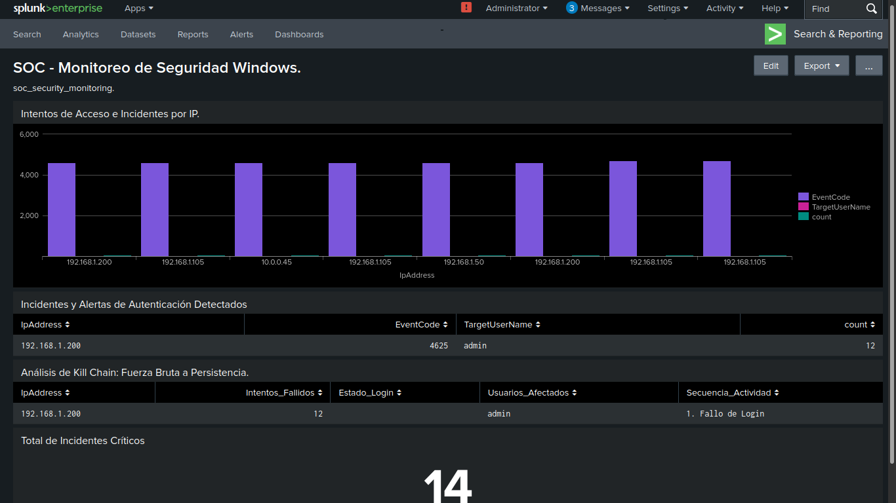

# 🔍 Enterprise SIEM Threat Hunting & SPL Queries Lab (Splunk Enterprise)

> Laboratorio práctico de análisis de logs, consultas SPL en Splunk y mapeo de amenazas bajo el marco MITRE ATT&CK.

---

## 📌 Resumen Ejecutivo

Este repositorio documenta el desarrollo de consultas avanzadas en **Splunk Search Processing Language (SPL)**, creación de dashboards de seguridad y análisis de eventos de Windows para la detección proactiva de amenazas dentro de un Centro de Operaciones de Seguridad (SOC).

---

## 🛠️ Stack Tecnológico

* **SIEM:** Splunk Enterprise / Splunk Free
* **Fuentes de Datos:** Logs de Windows Server (`WinEventLog:Security` y Sysmon)
* **Lenguaje de Consulta:** SPL (Search Processing Language)
* **Marco de Amenazas:** MITRE ATT&CK

---

## 📊 Visualización del Dashboard



---

## 📑 Casos de Uso y Consultas SPL Documentadas

En la carpeta [`/queries/`](queries/soc_detections.spl) encontrarás los scripts y consultas estructuradas para:

1. **Detección de Fuerza Bruta (`EventCode 4625`):** Filtrado y conteo de intentos fallidos de autenticación por IP y usuario.
2. **Monitoreo de Creación de Cuentas (`EventCode 4720`):** Auditoría de cuentas creadas localmente o en Active Directory.
3. **Modificación de Grupos Privilegiados (`EventCode 4732`):** Alertas sobre escalación de privilegios hacia grupos de administradores.

---

## 🎯 Competencias Clave Validadas

* Dominio de sintaxis y comandos de Splunk SPL (`stats count by`, `timechart`, `eval`, `rex`, `where`).
* Creación de alertas en tiempo real y visualizaciones analíticas.
* Alineación de telemetría con tácticas y técnicas del marco MITRE ATT&CK.

---

## 📁 Estructura del Repositorio

```text
├── assets/
│   └── dashboard_soc_view.png   # Captura de pantalla del Dashboard de Splunk
├── queries/
│   └── soc_detections.spl       # Consultas SPL organizadas por caso de uso
└── README.md                    # Documentación principal del laboratorio
